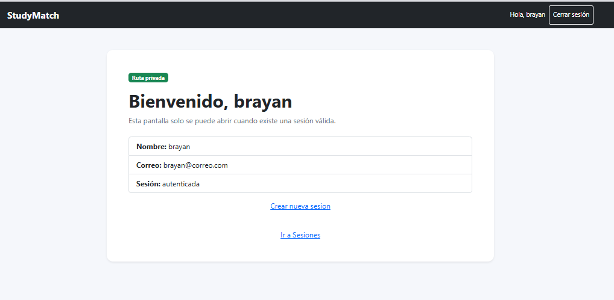
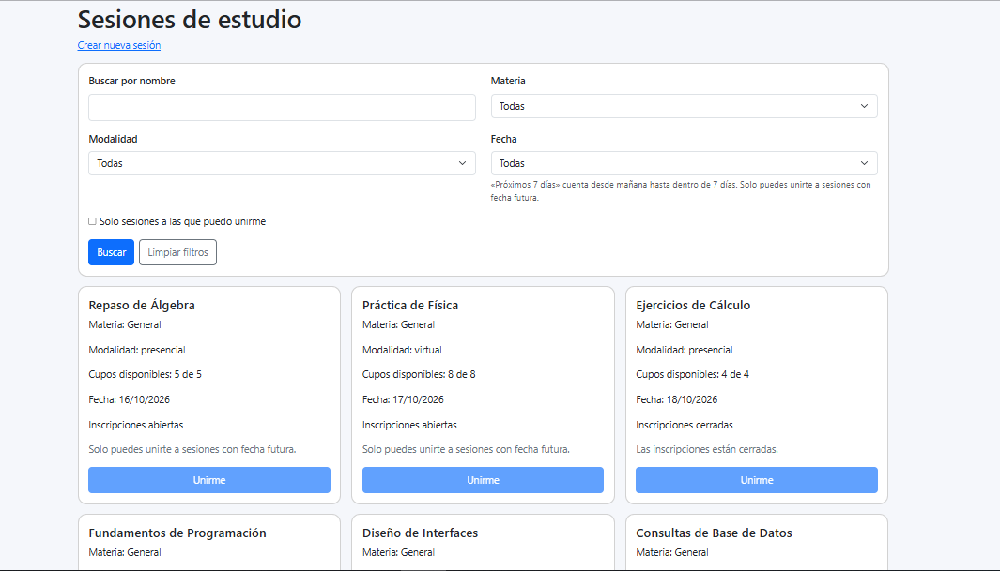

# Decisiones de interacción · Historial

| Principio | Decisión | Código |
| --- | --- | --- |
| Fitts | El acceso a Mi historial es un botón con mayor área clicable que los enlaces del panel. | frontend/src/Dashboard.jsx |
| Hick | Se muestran solo las inscripciones propias y dos opciones de navegación. Así se evita revisar todo el catálogo. | frontend/src/HistorialPage.jsx |
| Carga cognitiva | Cada tarjeta reúne la sesión, sus fechas y el resultado. | frontend/src/HistorialPage.jsx |

## Antes

## Después

