# Evaluación heurística H1–H10

**Proyecto:** StudyMatch.  
**Funcionalidad:** buscar una sesión de estudio y unirse, en `/sesions`.

La tabla contiene enlaces a las capturas. Las imágenes completas están debajo de cada heurística.

| Pantalla y evidencia | Heurística | Estado | Severidad | Después del arreglo |
| --- | --- | --- | --- | --- |
| Inscripción completada · [Ver captura](evidencias/clase-15/H1-inscripcion.JPG) | H1 · Visibilidad del estado del sistema | Cumple | — | — |
| Fecha de una sesión · [Ver captura](evidencias/clase-15/H2-fecha-antes.JPG) | H2 · Relación con el mundo real | Corregida | 0 (antes 1) | [Ver captura](evidencias/clase-15/H2-fecha-despues.JPG) |
| Filtros y opciones para salir · [Ver captura](evidencias/clase-15/H3-controles.JPG) | H3 · Control y libertad | Cumple | — | — |
| Tarjetas del listado · [Ver captura](evidencias/clase-15/H4-tarjetas.JPG) | H4 · Consistencia y estándares | Cumple | — | — |
| Inscripción bloqueada · [Ver captura](evidencias/clase-15/H5-bloqueo.JPG) | H5 · Prevención de errores | Cumple | — | — |
| Datos y filtros visibles · [Ver captura](evidencias/clase-15/H6-datos.JPG) | H6 · Reconocer antes que recordar | Cumple | — | — |
| Búsqueda con filtros · [Antes de recargar](evidencias/clase-15/H7-busqueda-antes.JPG) · [Después de recargar](evidencias/clase-15/H7-busqueda-despues.JPG) | H7 · Flexibilidad y eficiencia | Cumple | — | — |
| Listado de sesiones · [Ver captura](evidencias/clase-15/H8-diseno-minimalista.JPG) | H8 · Diseño estético y minimalista | Cumple | — | — |
| Error de conexión · [Ver captura](evidencias/clase-15/H9-conexion-antes.JPG) | H9 · Reconocer y recuperarse de errores | Corregida | 0 (antes 2) | [Ver captura](evidencias/clase-15/H9-conexion-despues.JPG) |
| Filtro de fecha sin explicación · [Ver captura](evidencias/clase-15/H10-ayuda-antes.JPG) | H10 · Ayuda y documentación | Corregida | 0 (antes 2) | [Ver captura](evidencias/clase-15/H10-ayuda-despues.JPG) |

## H1 · Visibilidad del estado del sistema

Al unirse aparece **Inscribiendo...**, luego un mensaje de éxito y **Ya estás inscrito**. También se actualizan los cupos.

Código: `frontend/src/SesionsPage.jsx`, función `unirse` y mensajes del listado.

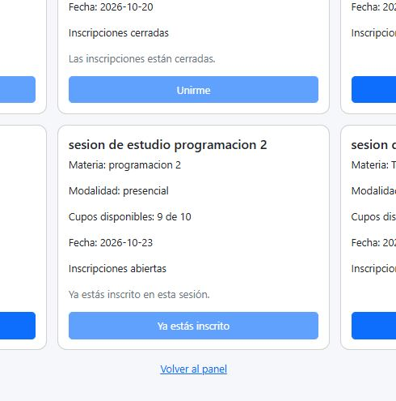

## H2 · Relación con el mundo real

Antes la fecha aparecía como **2026-10-25**. Ahora se muestra como **25/10/2026**, sin cambiar el día guardado.

Código: `frontend/src/SesionsPage.jsx`, función `formatearFecha`.

**Antes**

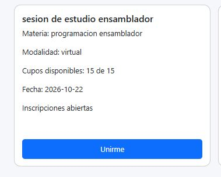

**Después**

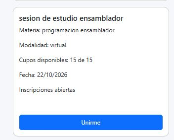

## H3 · Control y libertad

En la búsqueda se puede quitar un filtro con **×**, usar **Limpiar filtros** o **Volver al panel**.

Código: `frontend/src/SesionsPage.jsx`, `quitarFiltro` y botones de navegación.

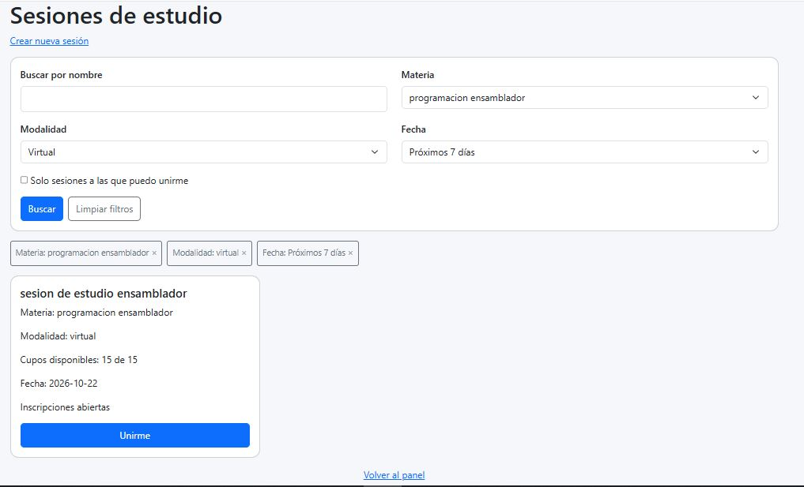

## H4 · Consistencia y estándares

Las tarjetas muestran los datos en el mismo orden y usan el mismo botón **Unirme**.

Código: `frontend/src/SesionsPage.jsx`, tarjetas dentro de `sesiones.map`.

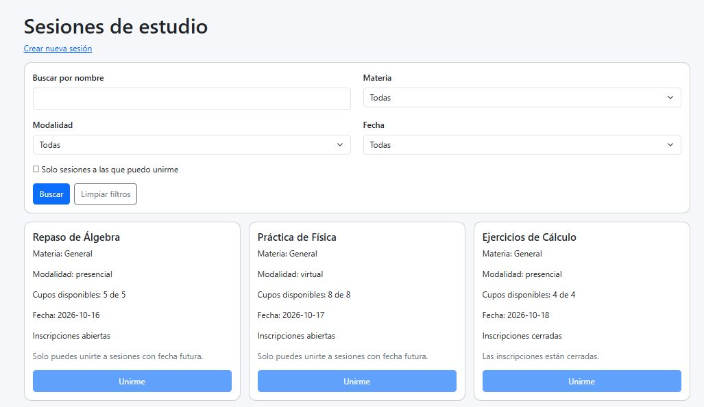

## H5 · Prevención de errores

**Unirme** se bloquea si la sesión es propia, está cerrada, no tiene cupos, no tiene fecha futura o ya existe una inscripción. Se muestra el motivo y el servidor también lo valida.

Código: `backend/app/repositorio.py`, `motivo_para_unirse` y `unirse_a_sesion`; botón en `SesionsPage.jsx`.

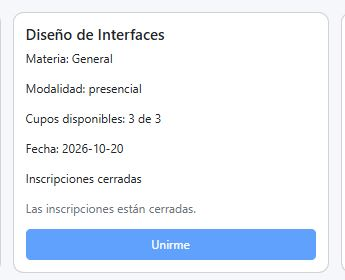

## H6 · Reconocer antes que recordar

La tarjeta muestra materia, modalidad, fecha y cupos. Los filtros aplicados también quedan visibles.

Código: `frontend/src/SesionsPage.jsx`, filtros activos y tarjetas.

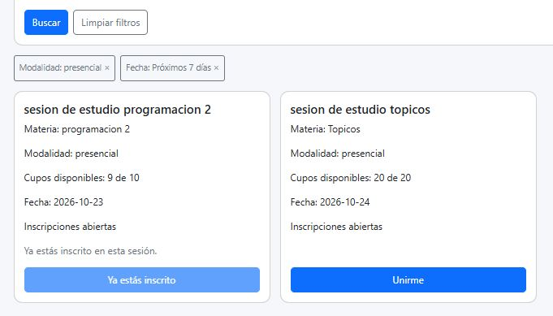

## H7 · Flexibilidad y eficiencia

Se pueden combinar filtros. Al pulsar **Buscar**, quedan en la URL y se conservan al recargar.

Código: `frontend/src/SesionsPage.jsx`, `aplicarFiltros` y `useSearchParams`.

**Antes de recargar**

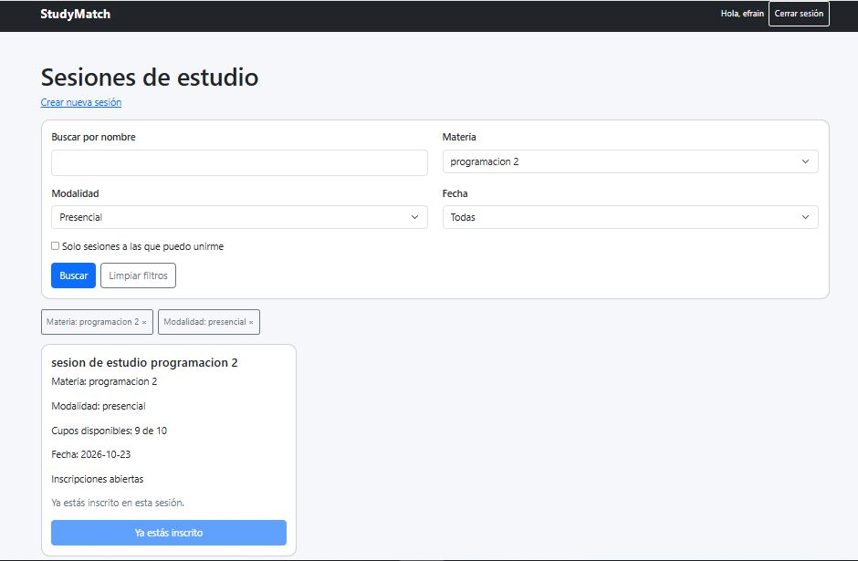

**Después de recargar**

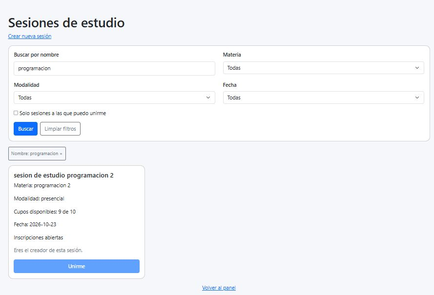

## H8 · Diseño estético y minimalista

Cada tarjeta reúne la información de la sesión y una acción para unirse.

Código: `frontend/src/SesionsPage.jsx`, contenido de las tarjetas.

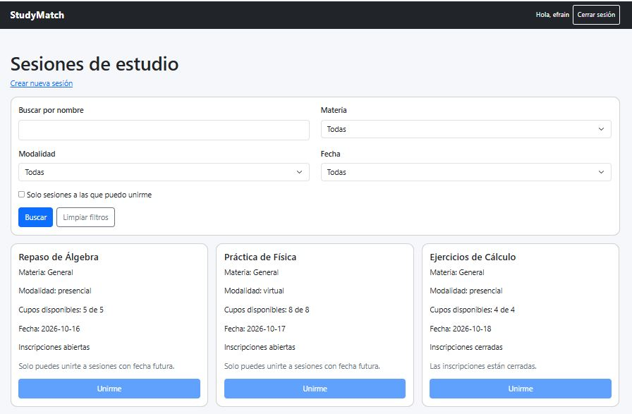

## H9 · Reconocer y recuperarse de errores

Antes un fallo de conexión mostraba un error técnico. Ahora se explica el problema en español y aparece **Reintentar** para volver a cargar sin perder los filtros.

Código: `frontend/src/api.js`, `apiRequest`; captura del error en `SesionsPage.jsx`.

**Antes**

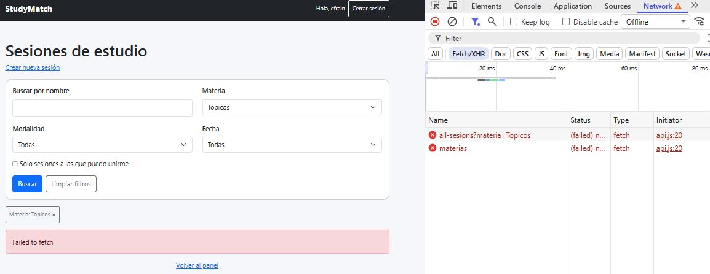

**Después**

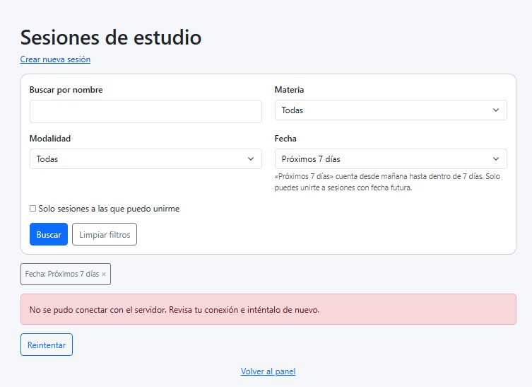

## H10 · Ayuda y documentación

Antes faltaba explicar las fechas. Ahora hay una nota junto al filtro: **Próximos 7 días** cuenta desde mañana y solo se permite unirse a sesiones con fecha futura.

Código: `frontend/src/SesionsPage.jsx`, selector de fecha; reglas en `backend/app/repositorio.py`.

**Antes**

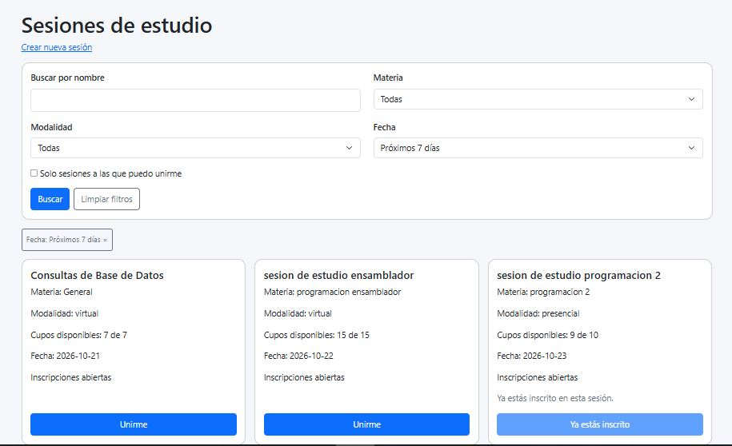

**Después**

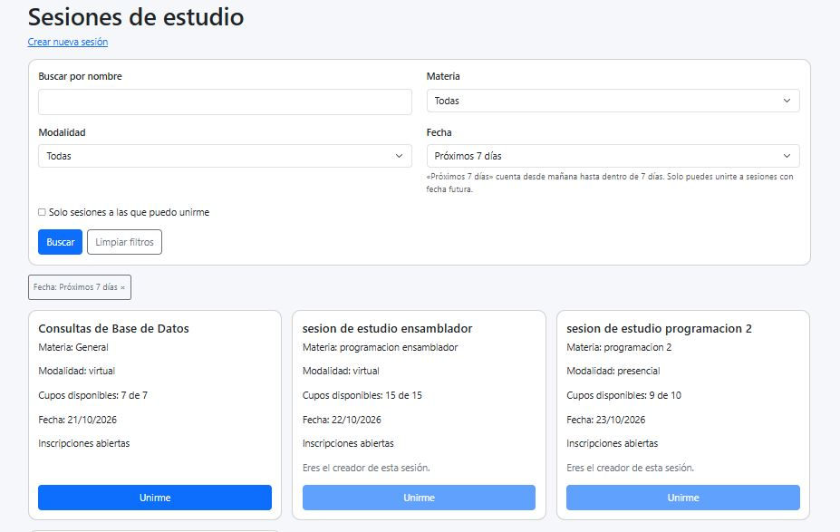

