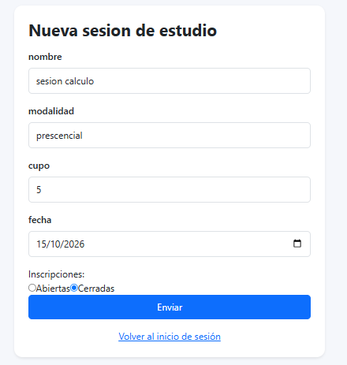
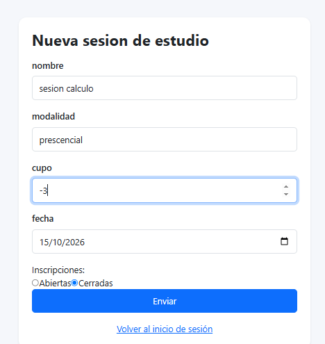
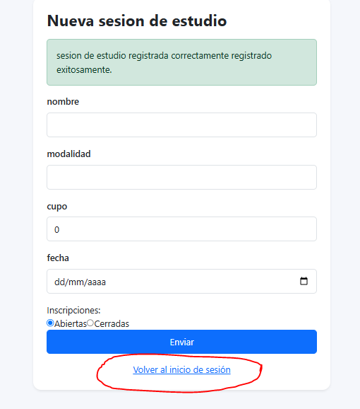
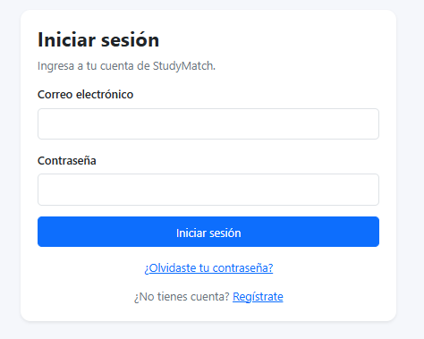

# TRABAJO EN CLASE · EVIDENCIA

## Registren los tres hallazgos antes de elegir uno.

| # | Pantalla y evidencia             | Problema y consecuencia | Heurística | Severidad |
|---|---                               |---                      |---         |---|
| 1 | Captura o paso exacto del flujo. | Qué ocurre y cómo afecta la tarea. | H1-H10 y justificación breve. | 0-4 |
| 2 |            | el backen responde: debes definir el estado de las sesiones, pero ya esta definido como cerrado |  H9 explicacion y recuperacion de errores | - 3|
| 3 |   | no hay validacion de numeros, el usuario puede typear numeros negativos, puede guardar una sesion con numero negativo | H5 prevencion | 3 |
| 4 |   | lleva al login a pesar de que el usuario ya esta autenticado | H3: control y libertad | 2 |

> **Elijan el hallazgo por su impacto en la tarea, no porque sea el cambio visual más rápido.**